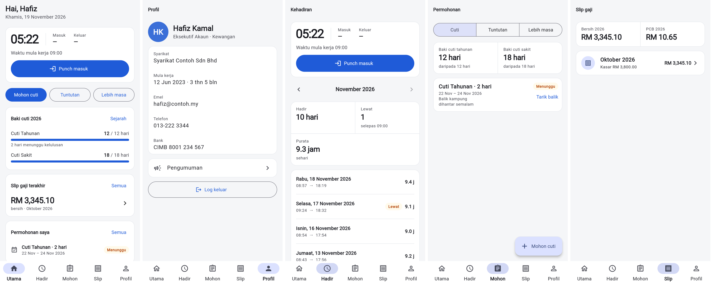
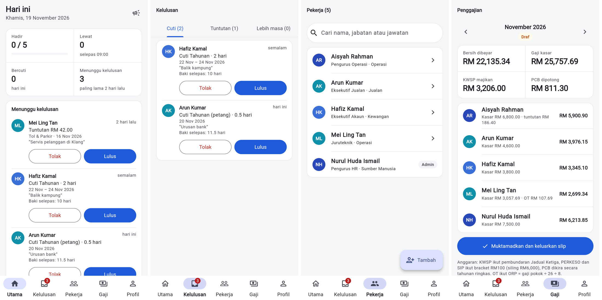

# Amin Studio HR (Flutter)

Aplikasi mudah alih HR untuk SME Malaysia: kehadiran, cuti, tuntutan, lebih masa, kelulusan, penggajian (KWSP, PERKESO, SIP, PCB) dan slip gaji. Satu kod untuk Android, iOS dan web.

## Jalankan

```bash
flutter pub get
flutter run            # pilih telefon, emulator atau Chrome
flutter test           # 9 ujian: kiraan caruman, baki cuti, kelulusan, gaji, log masuk
```




Dibina dan diuji dengan Flutter 3.50 (Dart 3.14). Material diimport melalui pakej `material_ui`, mengikut Flutter 3.47 ke atas.

## Akaun demo

Skrin log masuk menyenaraikan akaun contoh:

- **Nurul Huda Ismail** (Pengurus HR) nampak papan utama, kelulusan, pekerja dan penggajian.
- **Aisyah, Arun, Hafiz, Mei Ling** (pekerja) nampak punch masuk, baki cuti, permohonan dan slip gaji.

Data disimpan dalam peranti (`shared_preferences`). "Set semula data demo" di skrin log masuk memulihkan data contoh.

## Struktur

| Fail | Isi |
|---|---|
| `lib/models.dart` | Pekerja, permohonan (cuti/tuntutan/OT dalam satu jenis), kehadiran, slip gaji, tetapan |
| `lib/payroll.dart` | KWSP (pembundaran Jadual Ketiga), PERKESO & SIP (bracket RM100, siling RM6,000), PCB ringkas |
| `lib/store.dart` | `HrStore`: semua data dan tindakan, simpan ke peranti |
| `lib/theme.dart` | Tema Material 3, satu biru utama, warna status sahaja untuk oren/hijau/merah |
| `lib/screens/` | Skrin pekerja (utama, kehadiran, permohonan, slip) dan pengurus (utama, kelulusan, pekerja, gaji) |
| `lib/widgets/common.dart` | Komponen kongsi: kad seksyen, jalur angka, status, baris kelulusan |

## Langkah seterusnya untuk produksi

1. **Backend dan log masuk sebenar.** Ganti `load()`/`_save()` dalam `HrStore` dengan Supabase atau Firebase. Peraturan akses: pekerja hanya baca data sendiri; hanya pengurus boleh lulus dan ubah gaji.
2. **Punch dengan lokasi atau selfie** (`geolocator`, `camera`) untuk elak punch palsu.
3. **Notifikasi tolak** (FCM) bila permohonan diluluskan atau slip keluar.
4. **Slip gaji PDF** (`pdf`, `printing`).
5. **Semak kiraan caruman** dengan jadual rasmi KWSP/PERKESO dan Kalkulator PCB LHDN sebelum bayar gaji sebenar.

## Prototaip web

`prototype/pejabat-hr.html` ialah versi web satu halaman yang mendahului app ini (papan utama, kelulusan, penggajian, analitik, log audit dan pembantu AI). Ia direka untuk dijalankan sebagai Artifact di claude.ai dan menyimpan data melalui runtime itu; dibuka terus dalam pelayar, ia berjalan dalam mod demo.

## Deploy ke Vercel

Projek Vercel yang disambung ke repo ini membina versi web secara automatik setiap kali `main` dikemas kini. `vercel.json` memasang Flutter (versi dalam `scripts/vercel-install.sh`) semasa build dan menerbitkan `build/web`. Tiada tetapan tambahan diperlukan di papan pemuka Vercel; biarkan Framework Preset sebagai "Other".

## Jenama

Logo Amin Studio (kamera dengan huruf A dalam lensa) dilukis semula daripada signboard kedai. Sumber SVG ada dalam `docs/brand/`: `mark-rounded.svg` untuk web dan Android, `mark-full.svg` untuk iOS, `mark-maskable.svg` untuk ikon adaptif. Warna: kuning `#FFCE00`, hitam `#141414`, merah `#E0241B`.
